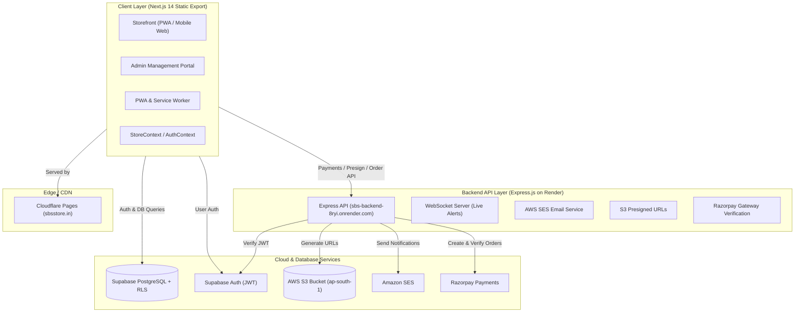

# SBS Store (`sbsstore.in`) — Architecture & Developer Documentation

Welcome to **SBS Store** (Shyam Bombay Sale), a full-stack, mobile-first e-commerce web application and Progressive Web App (PWA) with a customer storefront and back-office administration portal.

---

## 1. System Architecture



- **Frontend Hosting**: Cloudflare Pages (`sbsstore.in`, `sbs-store.pages.dev`) via Next.js `output: 'export'` (pure static assets in `out/`).
- **Backend API**: Node.js Express server on Render (`https://sbs-backend-8ryi.onrender.com`).
- **Database & Auth**: Supabase PostgreSQL with strict Row Level Security (RLS) policies.
- **Storage**: AWS S3 in `ap-south-1` (`sbs-store-media-748439418595`) with client-side image compression and server presigned URLs.
- **Email Service**: AWS SES for automated transactional order confirmations, tracking alerts, and welcome emails.
- **Payments**: Razorpay with client-side checkout and backend HMAC SHA-256 signature verification.

---

## 2. Directory Structure

```
sbs web/
├── AGENTS.md                  # System & agent rules (automatically loaded into AI context)
├── CLAUDE.md                  # Claude/agent instructions
├── README.md                  # Complete technical blueprint (this file)
├── next.config.mjs            # Next.js static export config (output: 'export', unoptimized images)
├── tailwind.config.js         # Tailwind configuration & theme styling
├── tsconfig.json              # TypeScript compilation setup
├── supabase_schema.sql        # Core database schema & table definitions
├── supabase_security_hardening.sql # Strict RLS policies, admin whitelist & triggers
│
├── src/
│   ├── app/                   # Next.js App Router pages
│   │   ├── layout.tsx         # Root layout with providers & global metadata
│   │   ├── page.tsx           # Home entry point (routes between views)
│   │   ├── product/[id]/      # Pre-rendered crawlable static product pages (schema.org/Product)
│   │   ├── category/[id]/     # Pre-rendered department hub pages (CollectionPage & ItemList)
│   │   ├── sitemap.ts         # Dynamic XML Sitemap generator
│   │   ├── about/             # About Us page
│   │   ├── contact/           # Contact Us page
│   │   ├── orders/            # Orders list page
│   │   ├── order-success/     # Order placement success page
│   │   ├── privacy/           # Privacy policy
│   │   ├── terms/             # Terms and conditions
│   │   ├── refund-policy/     # Refund & cancellation policy
│   │   └── shipping-policy/   # Shipping policy
│   │
│   ├── scripts/
│   │   └── generateSeoFeeds.mjs # Pre-build generator for sitemap.xml & Google Merchant feed.xml
│   │
│   ├── components/            # UI Components
│   │   ├── BottomNav.tsx      # Mobile app bottom navigation bar
│   │   ├── Header.tsx         # Main header with search, cart badge, admin link
│   │   ├── ProductCard.tsx    # Responsive product card with discount badges
│   │   ├── ProductStories.tsx # Instagram-style interactive story circles
│   │   ├── FloatingQuickCart.tsx # Floating mini-cart drawer
│   │   ├── FlyToCartAnimation.tsx# Visual flying particle animation on Add-to-Cart
│   │   ├── MobileBackHandler.tsx # Handles browser back gesture on mobile/PWA
│   │   │
│   │   ├── admin/             # Admin portal components
│   │   │   ├── AdminHeader.tsx
│   │   │   ├── AdminMobileNav.tsx
│   │   │   ├── AddEditProductModal.tsx
│   │   │   ├── AdminGlobalSearchModal.tsx
│   │   │   ├── HomepagePreviewModal.tsx
│   │   │   ├── OrderDetailsModal.tsx
│   │   │   ├── ProductSelectorModal.tsx
│   │   │   └── views/         # Admin sub-views (Dashboard, Products, Orders, Inventory,
│   │   │                      # Analytics, Categories, Offers, Customers, Roles, Settings)
│   │   │
│   │   ├── common/            # Shared primitives (BarcodeScanner, PincodeChecker, Skeletons)
│   │   ├── modals/            # Modals (Auth, Checkout, ProductDetail, Addresses, Rewards, etc.)
│   │   └── views/             # Main client tabs (HomeView, CartView, CategoriesView, WishlistView, etc.)
│   │
│   ├── context/               # Global React Contexts
│   │   ├── AuthContext.tsx    # Supabase auth state, user profile, role verification
│   │   ├── StoreContext.tsx   # Catalog, cart, wishlist, orders, coupons, active tab state
│   │   └── PWAContext.tsx     # PWA installation banner, offline status
│   │
│   ├── hooks/                 # Reusable React hooks (useMediaUrl, usePWAInstall)
│   ├── lib/                   # Utility libraries (supabase.ts, imageCompression.ts, mediaStorage.ts)
│   ├── types/                 # Shared TypeScript interfaces (Product, Order, Category, etc.)
│   └── utils/                 # Utility helpers (confetti.ts, pushNotifications.ts)
│
├── server/                    # Node.js Backend API
│   ├── server.js              # Express API (Razorpay, S3 Presigned URLs, Admin Auth, Health)
│   ├── package.json           # Backend dependencies (AWS SDK, Razorpay, Express, Supabase)
│   └── services/
│       └── emailService.js    # AWS SES transactional email templates & dispatch logic
```

---

## 3. Core Database Tables (Supabase PostgreSQL)

| Table | Purpose | Access Control |
| :--- | :--- | :--- |
| `products` | Product catalog, pricing, stock, images, gallery, videos | Public Read / Authenticated Admin Write |
| `categories` | Product categories, colors, sort orders | Public Read / Authenticated Admin Write |
| `profiles` | Customer profile, addresses count, reward points | Own User Read/Write (`auth.uid() = id`) |
| `cart_items` | Persistent user shopping carts | Own User Read/Write (`auth.uid() = user_id`) |
| `wishlist_items` | Persistent user wishlists | Own User Read/Write (`auth.uid() = user_id`) |
| `orders` | Completed orders, payment status, tracking numbers | Own User Read, Admin Read/Write |
| `coupons` | Promo codes, discount rules, expiry dates | Public Read / Admin Manage |
| `store_settings` | Store configuration (shipping rates, announcement text) | Public Read / Admin Manage |
| `admin_team_members` | Role-based team access whitelist | Admin Only |
| `returns` | Return & refund requests | User Read/Create, Admin Manage |
| `customer_notifications` | Push & in-app alerts sent to users | Own User Read |

> **Admin Whitelist**: The primary admin emails hardcoded and verified in Supabase RLS and the Express backend are:
> - `mahipalstudent71@gmail.com`
> - `shyambombaysale@gmail.com`
> - `mahipalworld71@gmail.com`
> - `devanshipatel564@gmail.com`

---

## 4. Backend Endpoints (`server/server.js`)

Base URL: `https://sbs-backend-8ryi.onrender.com` (or `http://localhost:5000` in dev)

| Method | Endpoint | Description |
| :--- | :--- | :--- |
| `GET` | `/health` | Server status and AWS/Razorpay configuration health check |
| `POST` | `/api/s3/presigned-url` | Generates AWS S3 PUT presigned URL for direct secure uploads |
| `GET` | `/api/s3/view-url` | Generates AWS S3 GET presigned URL for viewing media |
| `POST` | `/api/razorpay/create-order` | Creates a Razorpay order with subtotal, discount, and tax |
| `POST` | `/api/razorpay/verify-payment` | Validates HMAC SHA-256 signature and records transaction |
| `POST` | `/api/email/order-confirmation` | Dispatches order receipt via AWS SES |
| `POST` | `/api/email/order-status-update`| Sends status transition email (Shipped, Out for Delivery, Delivered) |
| `POST` | `/api/email/welcome` | Dispatches new customer welcome email |

---

## 5. Environment Variables Reference

### Frontend (`.env.local`):
```env
NEXT_PUBLIC_SUPABASE_URL=https://pclwoyqrlfyqfqojhmag.supabase.co
NEXT_PUBLIC_SUPABASE_ANON_KEY=<SUPABASE_ANON_KEY>
NEXT_PUBLIC_API_URL=https://sbs-backend-8ryi.onrender.com
NEXT_PUBLIC_RAZORPAY_KEY_ID=<RAZORPAY_KEY_ID>
```

### Backend (`server/.env`):
```env
PORT=5000
FRONTEND_URL=https://sbsstore.in
SUPABASE_URL=https://pclwoyqrlfyqfqojhmag.supabase.co
SUPABASE_SERVICE_ROLE_KEY=<SUPABASE_SERVICE_ROLE_KEY>
AWS_REGION=ap-south-1
AWS_S3_BUCKET=sbs-store-media-748439418595
AWS_ACCESS_KEY_ID=<AWS_ACCESS_KEY_ID>
AWS_SECRET_ACCESS_KEY=<AWS_SECRET_ACCESS_KEY>
RAZORPAY_KEY_ID=<RAZORPAY_KEY_ID>
RAZORPAY_KEY_SECRET=<RAZORPAY_KEY_SECRET>
SES_FROM_EMAIL=orders@sbsstore.in
```

---

## 6. Development & Deployment Commands

### Frontend:
```bash
# Start local development server (http://localhost:3000)
npm run dev

# Build production static export (outputs to ./out/)
npm run build

# Run Next.js linter
npm run lint
```

### Backend:
```bash
# Start Express backend locally (http://localhost:5000)
npm run start:server
# or inside /server:
node server.js
```

---

## 7. Guidelines for AI Assistants & Pair Programmers

1. **Static Export Discipline**: Next.js is configured for `output: 'export'`. Do not use SSR (`getServerSideProps`) or dynamic Node-runtime Next.js API routes (`/api/...`) that require a live Next.js server. All dynamic backend actions belong in `server/server.js`.
2. **Media Optimization**: Always use `src/lib/imageCompression.ts` before uploading user or product images to AWS S3 to maintain high performance.
3. **AWS Security & Secrets**: Never log or expose AWS secrets or Supabase service role keys to client code. When interacting with AWS tools, follow the guidelines in `AGENTS.md`.
4. **State Management**: Client UI state and cart/orders are synchronized through `StoreContext` and `AuthContext`. Prefer existing context actions rather than ad-hoc queries where state caching is expected.
